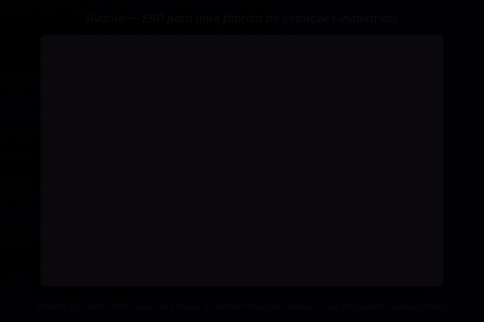

# Avante — ERP para uma fábrica de vedações industriais

**Site institucional e área de gestão (clientes, estoque e pedidos) para uma fábrica de peças de vedação que atende mineração e indústria.** O ponto central é o pedido: vários itens por pedido e baixa de estoque na mesma transação, respeitando o que é produzido sob encomenda e o que sai do estoque.



<sub>Vídeo em MP4: [docs/media/avante-demo.mp4](docs/media/avante-demo.mp4) · dados fictícios gerados por `prisma/seed.ts`</sub>

## O problema

Parte das peças (anéis, retentores) sai de estoque; outra parte (coxins, buchas e réguas de impacto para britador) é torneada sob encomenda. O sistema precisa registrar pedidos com vários itens sem deixar o estoque divergir do que foi vendido — e, ao mesmo tempo, ser a vitrine da empresa na internet.

## Como funciona

```
Site (/)  ── contato por WhatsApp e e-mail
   │
Portal do cliente (/login) ── Better Auth (e-mail + senha) ── middleware protege /dashboard
   │
/dashboard ── telas em React (shadcn/ui, TanStack Table, React Hook Form + Zod)
   │            │  estado com Zustand (um store por recurso)
   ▼            ▼
API Routes (/api/clientes, /api/produtos, /api/categorias, /api/pedidos)
   │
Prisma ── PostgreSQL
```

Modelo de dados:

```
Category 1─N Products        Products.productionType = EM_ESTOQUE | SOB_ENCOMENDA
Customers 1─N Orders         Products.stock só vale para EM_ESTOQUE
Orders N─N Products via OrderItems (quantity, unitPrice)   @@unique([orderId, productId])
```

## Decisões e trade-offs

- **Estoque × sob encomenda no modelo, não em `if` espalhado.** `productionType` decide se um item mexe no estoque. Peças sob encomenda nunca bloqueiam pedido por falta de estoque.
- **Baixa de estoque transacional.** Criar, editar e excluir pedido rodam em `prisma.$transaction`: a criação decrementa o estoque dos itens `EM_ESTOQUE`; a edição calcula o delta por produto (incrementa ou decrementa só a diferença, e devolve o estoque de itens removidos); a exclusão devolve tudo.
- **Preço gravado no item.** `OrderItems.unitPrice` guarda o preço praticado no pedido; mudar o preço do produto depois não altera pedidos antigos. O total é calculado no servidor.
- **Um produto por pedido.** `@@unique([orderId, productId])` impede linhas duplicadas; a tela de itens também esconde produtos já escolhidos.
- **Decimal normalizado na borda.** A API converte `Prisma.Decimal` para `number` antes de responder, então o front-end não precisa conhecer tipos do ORM.
- **Trade-off conhecido:** a checagem de estoque acontece antes da transação. Para o volume atual é suficiente; com concorrência alta, o próximo passo é um decremento condicional (`where: { stock: { gte: qtd } }`) dentro da própria transação.

## Resultado

Beta publicado em [avante-beta.vercel.app](https://avante-beta.vercel.app): site institucional e área de gestão com clientes, produtos, categorias e pedidos com vários itens e baixa automática de estoque.

Pendências: o *Painel de Controle* ainda mostra indicadores ilustrativos (estáticos) e os testes de componentes (Jest + Testing Library) precisam ser atualizados para os modais atuais.

## Stack

Next.js 15 (App Router) · React 19 · TypeScript · Prisma · PostgreSQL · Better Auth · Zustand · React Hook Form + Zod · TanStack Table · shadcn/ui (Radix) · Recharts · Tailwind CSS 4

## Como rodar

Requer Node 20+ e um PostgreSQL (local ou Supabase).

```bash
npm install
cp .env.example .env          # preencha DATABASE_URL e BETTER_AUTH_SECRET
npx prisma migrate deploy     # aplica prisma/migrations
npx prisma generate           # gera o client em generated/prisma
npx tsx prisma/seed.ts        # dados 100% fictícios
npm run dev
```

Crie o usuário de acesso em `/cadastro` (por exemplo `demo@exemplo.com`) e entre pelo *Portal do Cliente*.

---

Feito por [Felipe Sobrinho](https://felipe-nephew.vercel.app)
